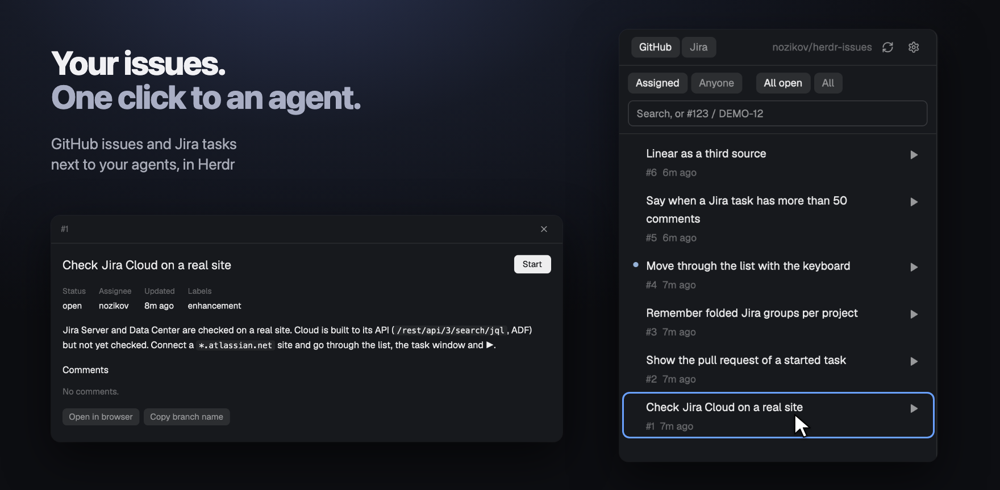
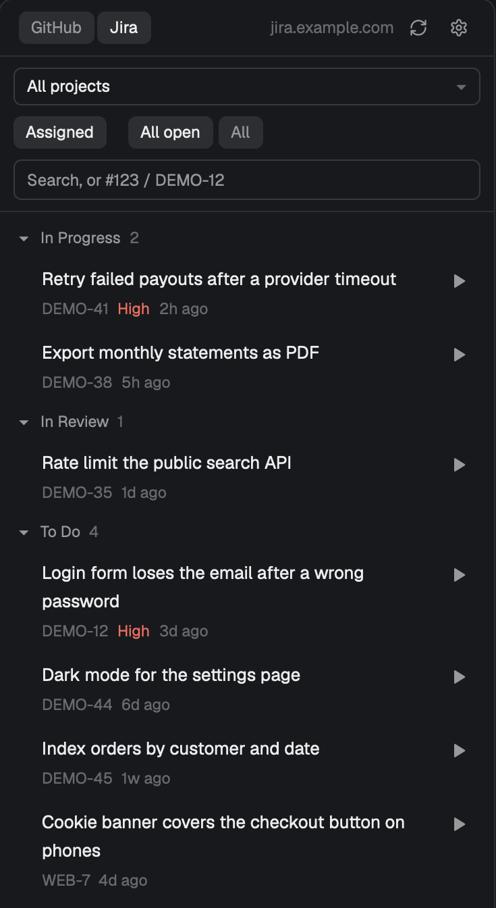
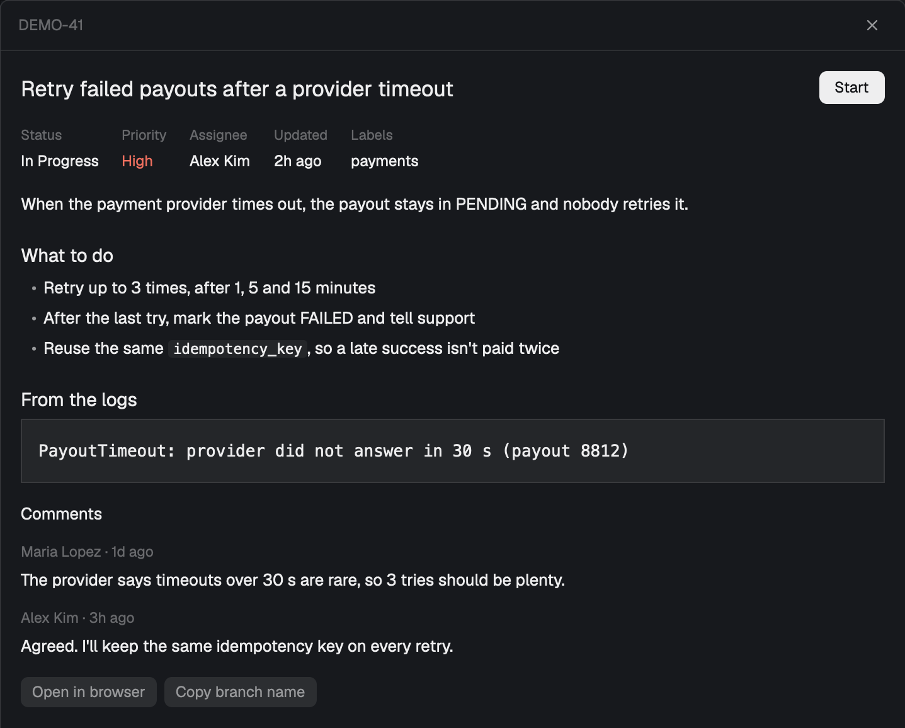
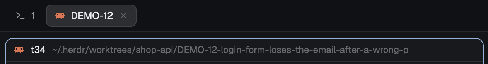
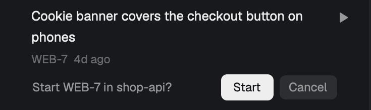
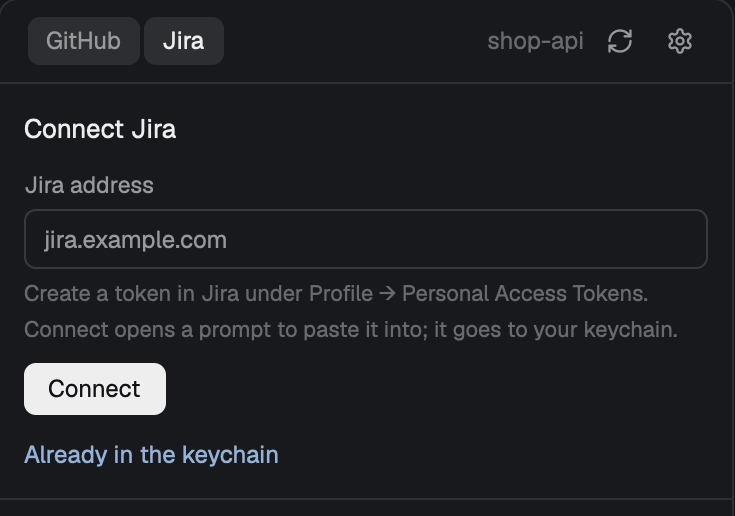

<p align="center">
  
</p>

<h1 align="center">Issue to agent</h1>

<p align="center"><strong>Your GitHub issues and Jira tasks next to your agents. One click starts an agent on one.</strong></p>

<p align="center">
  <a href="LICENSE"></a>
  <a href="https://herdr.dev/mods"></a>
  
  
</p>

<p align="center">
  <a href="#install">Install</a> · <a href="#the-panel">Panel</a> · <a href="#read-a-task">Read a task</a> · <a href="#start-a-task">Start a task</a> · <a href="#connect-jira">Jira</a> · <a href="#what-it-runs">What it runs</a> · <a href="RECIPE.md">Recipe</a>
</p>

<br>

See the tasks for the project you're in, right beside your agents:

- **GitHub issues** for the repo, with no setup: it uses your `gh` login.
- **Jira tasks** from every project you work on, after you connect the site once.
- **▶ starts an agent** on a task in a new tab, on its own branch and folder, with the task as its first message.

It only reads the tracker, and your Jira token stays in the system keychain.

## The panel

<p align="center">
  
</p>

Click **Issues** in the tab bar. The panel shows the open tasks assigned to you, newest
first.

- **GitHub or Jira:** the switch at the top picks the source for this project, and the panel remembers it.
- **Jira tasks** group by status, with a count. Click a status to fold it. The dropdown narrows them to one project.
- **`High`** in red marks High, Highest, Critical and Blocker.
- **A dot** before a title means the work has started.
- **Search** by words, or type a key like `#128` or `DEMO-12` to find that task even if it isn't yours.

## Read a task

<p align="center">
  
</p>

Click a row. The task opens over your work with its description as the tracker formats it:
headings, lists, code. Below are the comments, `Open in browser` and `Copy branch name`.
Start is right there, and Esc closes it.

## Start a task

<p align="center">
  
</p>

Press ▶ on a row, or Start in the task window:

1. The branch `<key>-<title>` and the folder `~/.herdr/worktrees/<repo>/<branch>` are made with `git worktree`.
2. Your setup command runs in the new folder, if you set one, like `npm ci`.
3. Your agent starts in a new tab named after the task, with the task as its first message.

The first message has the key, the link and the description, and asks the agent to read
the rest in the tracker itself: comments, attachments, the epic and linked tasks. For
GitHub it does that with `gh`. For Jira it needs its own way in, like a Jira MCP server;
without one it works from the description. Change the message under the gear.

Your current work stays as it is. ▶ on a task that already has a tab goes to that tab.

<p align="center">
  
</p>

A repo's own Jira project comes first, guessed once from branch names like
`feature/DEMO-30-statement-totals`. A task from another project asks before it starts.

## Connect Jira

<p align="center">
  
</p>

Type your Jira address and press **Connect**. A tab opens with the system's password
prompt: paste your token there, and it goes straight to the keychain. The mod never sees
it typed.

- **Jira Server or Data Center:** create a personal access token under Profile.
- **Jira Cloud** (`*.atlassian.net`) also asks for your email. Create the token at id.atlassian.com.
- **Token already in the keychain?** Click **Already in the keychain** and give the item's name.

The gear opens the rest: the agent, the setup command, the first message, the home
project and the question before other projects.

## It plays safe

- **Read only.** Nothing is written to GitHub or Jira.
- **Tracker text is untrusted.** The first message marks it as written by anyone, images in it aren't loaded, and links open only on a click.
- **No task text reaches a shell,** a URL or a Jira query. Branch names are built from letters and digits only.
- **Remove folder asks first** and refuses while a terminal is open there or while there are uncommitted changes. It names the ignored files that would go, like `.env`, and keeps the branch, so ▶ brings the work back.
- **A failed refresh keeps the list** and says so. Nothing is fetched while the panel is hidden.

## Install

Ask your Herdr agent to add this repository:

```text
Add the Herdr mod github.com/nozikov/herdr-issues to my tab bar
```

Or by hand, on macOS or Linux, with `git` and the GitHub CLI `gh` signed in:

```sh
git clone https://github.com/nozikov/herdr-issues.git
cp -R herdr-issues/mods/issues ~/.config/herdr-app/mods/
herdr-app do layout.clone '{"name":"main","as":"my-main"}'
```

Then, in `~/.config/herdr-app/layouts/my-main.json`, add the panel to the `panel-body`
stack:

```json
{ "id": "issues", "type": "block", "content": { "mod": "issues" } }
```

And replace the `tabs` block with this row, which adds the **Issues** button:

```json
{ "id": "tabs-row", "type": "row", "size": { "px": 42 }, "resizable": false, "children": [
  { "id": "tabs", "type": "block", "size": { "weight": 1 }, "window_drag": true, "content": { "mod": "tabs" } },
  { "id": "issues-toggle", "type": "block", "size": { "px": 80 }, "window_drag": true,
    "content": { "mod": "issues", "props": { "view": "toggle" } } } ] }
```

## What it runs

- `gh`, to read issues with your own login.
- `git`, to read the repo and its branches, and to add and remove worktrees. It never deletes a branch.
- Jira's REST API, GET only, on the sites you connect, over HTTPS.
- `security` on macOS or `secret-tool` on Linux, to read the token. It stays in memory, never in a file, a log or a command line.
- Your setup command, if you set one, and your agent, as Herdr knows it. The mod adds no flags and turns off no approvals.

> [!NOTE]
> Jira Server and Data Center are checked on a real site. Jira Cloud is built to its API but not yet checked on a real site.

## Develop

```sh
rsync -a --delete mods/issues/ ~/.config/herdr-app/mods/issues/
npm test                                    # node --test, no dependencies
herdr-app check ~/.config/herdr-app/mods/issues
```

Copy the mod, don't symlink it: Herdr won't load icons through a symlinked mod
folder, so they'd be blank. It doesn't hot-reload either: after copying, switch
layouts away and back (`herdr-app do layout.switch '{"name":"main"}'`, then your layout).

[RECIPE.md](RECIPE.md) is the brief to build the mod from scratch.

## Credits

Screenshots are the real mod in a demo window: this repository's own issues, and a
sample Jira site with made-up tasks.
The icons follow [Lucide](https://lucide.dev) (ISC).

## License

[MIT](LICENSE)
