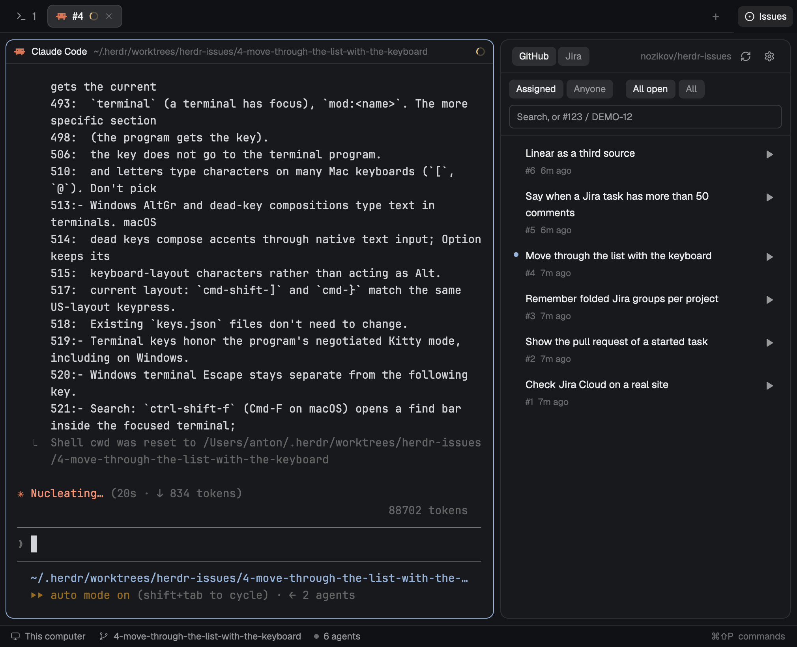
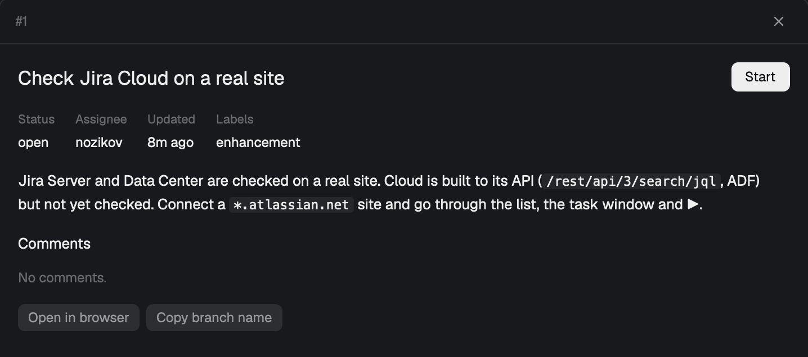

<p align="center">
  
</p>

<h1 align="center">Issues for Herdr</h1>

<p align="center"><strong>Your GitHub issues and Jira tasks next to your agents. One click starts an agent on one.</strong></p>

<p align="center">
  <a href="LICENSE"></a>
  <a href="https://herdr.dev/mods"></a>
  
  
</p>

<p align="center">
  <a href="#install">Install</a> · <a href="#the-panel">Panel</a> · <a href="#start-a-task">Start a task</a> · <a href="#connect-jira">Jira</a> · <a href="#what-it-runs">What it runs</a> · <a href="RECIPE.md">Recipe</a>
</p>

<br>

A side panel in Herdr with the tasks for the project you're in:

- **GitHub issues** for the repo, with no setup: it uses your `gh` login.
- **Jira tasks** from every project you work on, after you connect the site once.
- **▶ starts an agent** on a task in a new tab, on its own branch and folder, with the task as its first message.

It only reads the tracker. Your Jira token stays in the system keychain.

## The panel

Click **Issues** in the tab bar. The panel shows the open tasks assigned to you, newest
first. Switch to `Anyone` or `All`, or search. A key like `#128` or `DEMO-12` in the
search box finds that task even if it isn't yours.

- **GitHub or Jira:** the switch at the top picks the source for this project, and
  the panel remembers it.
- **Jira tasks** group by status. Pick a project in the dropdown to narrow them.
- **A dot** on a row means the work has started.

<p align="center">
  
</p>

Click a row to read the task: the description with its formatting, the comments,
`Open in browser` and `Copy branch name`. Esc closes it.

## Start a task

Press ▶ on a row, or Start in the task window:

1. The branch `<key>-<title>` and the folder `~/.herdr/worktrees/<repo>/<branch>` are made with `git worktree`.
2. Your setup command runs in the new folder, if you set one, like `npm ci`.
3. Your agent starts in a new tab of the same space, with the task as its first message.

The picture at the top is that moment: the agent works on #4 in its own folder, and the
row has a dot. Your current work stays as it is. ▶ on a task that already has a tab goes
to that tab.
**Remove folder** in the task window cleans up when you're done. It refuses while
something is running there or while there are uncommitted changes, and it keeps the
branch, so ▶ brings the work back.

## Connect Jira

Click the gear, type your Jira address and press **Connect**. A tab opens with the
system's password prompt. Paste your token there, and it goes straight to the keychain.

- **Jira Cloud** (`*.atlassian.net`) also asks for your email. Create the token at
  id.atlassian.com.
- **Jira Server or Data Center:** create a personal access token under Profile.
- **Token already in the keychain?** Give the name of that keychain item instead.

The panel lists your open tasks from every project. A repo's own project comes first,
guessed from branch names like `feature/DEMO-12-fix-login`. Starting a task from
another project asks first.

## Install

Ask your Herdr agent to add this repository:

```text
Add the Herdr mod github.com/nozikov/herdr-issues to my tab bar
```

Or by hand, on macOS or Linux, with `git` and the GitHub CLI `gh` signed in:

```sh
git clone https://github.com/nozikov/herdr-issues.git
cp -R herdr-issues/mods/issues ~/.config/herdr-app/mods/
herdr-app do layout.clone '{"name":"main","as":"my-main"}'
```

Then, in `~/.config/herdr-app/layouts/my-main.json`, add the panel to the `panel-body`
stack:

```json
{ "id": "issues", "type": "block", "content": { "mod": "issues" } }
```

And replace the `tabs` block with this row, which adds the **Issues** button:

```json
{ "id": "tabs-row", "type": "row", "size": { "px": 42 }, "resizable": false, "children": [
  { "id": "tabs", "type": "block", "size": { "weight": 1 }, "window_drag": true, "content": { "mod": "tabs" } },
  { "id": "issues-toggle", "type": "block", "size": { "px": 80 }, "window_drag": true,
    "content": { "mod": "issues", "props": { "view": "toggle" } } } ] }
```

## What it runs

- `gh`, to read issues with your own login. It writes nothing to GitHub.
- `git`, to read the repo and its branches, and to add and remove worktrees. It never deletes a branch.
- Jira's REST API, GET only, on the sites you connect, over HTTPS.
- `security` on macOS or `secret-tool` on Linux, to read the token. It stays in memory, never in a file, a log or a command line.
- Your setup command, if you set one, and your agent, as Herdr knows it. The mod adds no flags and turns off no approvals.
- No task text reaches a shell, a URL or a Jira query.

> [!NOTE]
> Jira Server and Data Center are checked on a real site. Jira Cloud is built to its API but not yet checked on a real site.

## Develop

```sh
rsync -a --delete mods/issues/ ~/.config/herdr-app/mods/issues/
npm test                                    # node --test, no dependencies
herdr-app check ~/.config/herdr-app/mods/issues
```

Copy the mod, don't symlink it: Herdr won't load icons through a symlinked mod
folder, so they'd be blank. It doesn't hot-reload either: after copying, switch
layouts away and back (`herdr-app do layout.switch '{"name":"main"}'`, then your layout).

[RECIPE.md](RECIPE.md) is the brief to build the mod from scratch.

## Credits

Screenshots are the real mod in a demo window, on this repository's own issues.
The icons follow [Lucide](https://lucide.dev) (ISC).

## License

[MIT](LICENSE)
