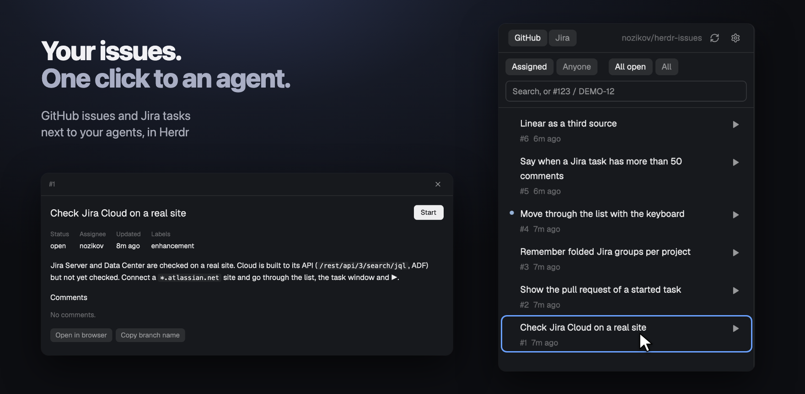

# Issue to agent

Your GitHub issues and Jira tasks in a side panel. ▶ on one starts an agent on
it in a new tab, on its own branch and git worktree, with the task as its first
message. It only reads the tracker, and the token stays in your keychain.



## What you see

- **Tab bar button:** the open-issue icon and `Issues`, drawn like the `tabs`
  mod's Files and Changes buttons, highlighted while the panel is open. A click
  shows or hides the panel.
- **Header:** a `GitHub | Jira` switch, the repo or site name, refresh, the
  gear. The switch sets this project's source. Going back to Jira keeps the site
  and the home project.
- **Filters:** for Jira, a project dropdown (`All projects`, then each project
  among your tasks). Then `Assigned` or `Anyone`, `All open` or `All`, and a
  search box. A Jira key or `#123` in the box looks up that exact task first,
  even if it isn't assigned to you.
- **List:** a row is the whole title, wrapped. Below it, small and dim, the key,
  `High` in the blocked color when the priority is High or above, and how long
  ago the task changed. ▶ is on the right. A small dot marks work already
  started.
- **Groups:** Jira tasks group by status, in the order Jira gives them, each with
  a count. A click folds a group. GitHub has no groups.
- **Task window:** a click on a row opens a dialog, closed with Esc. Title, Start
  (`Continue` when the work exists), status, priority, assignee, updated, labels,
  the description with its formatting, comments, `Open in browser`,
  `Copy branch name`, and `Remove folder` when the task has a folder.

## How it behaves

- **Which source:** a repo with a GitHub remote starts on GitHub with no setup:
  the one set with `gh repo set-default`, else `origin`, else the only one there
  is. Several and no `origin` aren't guessed: the panel says so. Any other repo
  starts on Jira. The switch moves a project either way.
  On GitHub with no remote, the panel says so and shows the
  `git remote add` command. It never moves to Jira on its own.
- **Connecting Jira:** one field, the site address. The type follows it:
  `*.atlassian.net` is Cloud and also asks for an email, anything else is
  Server/Data Center. `Connect` opens a tab with the system's prompt, you paste
  the token there, and it goes straight to the keychain. The mod never sees it
  typed.
- **Already in the keychain:** give the name of an existing keychain item
  instead. Only the name, not a command. The mod reads the item first, and saves
  the site only if that works.
- **All your Jira tasks:** a repo isn't tied to one Jira project. The panel lists
  your open tasks from every project, and the project dropdown narrows them,
  remembered per repo. `Anyone` needs a picked project, so the panel never asks
  for every task on the site.
- **Home project:** the repo's own Jira project. It's guessed once from branch
  names, like `DEMO` from `feature/DEMO-12-fix-login`, and counts only if the
  site confirms the project exists. Set or clear it under Advanced. Its tasks come
  first.
- **The question before ▶:** a task outside the home project asks under its row:
  "Start DEMO-12 in example-repo?", with Start and Cancel. Resuming work doesn't
  ask. Advanced has a switch to turn the question off.
- **▶:** if the task has a tab in any space of this project, it goes there and
  creates nothing. Otherwise it makes the branch `<key>-<title-slug>` and the
  folder `~/.herdr/worktrees/<repo>/<branch>`, runs the setup command if the
  folder is new, and starts the agent in a new tab with the task as its first
  message. The row shows the steps and any failure.
- **The first message** is a template with `{key}`, `{title}`, `{url}` and
  `{body}`. The body is plain text, cut at 8000 characters, and marked as coming
  from the tracker. Comments aren't sent.
- **Remove folder** asks first, and refuses while a terminal is in the folder or
  while it has uncommitted changes. There is no force option. The branch stays,
  so ▶ brings the work back later. Ignored files go with the folder, so the
  question names them: "Ignored files go too: .env, ...", up to 5 and "and N more",
  leaving out `node_modules`, `target`, `build`, `dist`, `.gradle` and `.venv`. If
  they changed since, nothing is removed.
- **Refreshing:** when the panel is shown, when the space changes, on the refresh
  button, and every 5 minutes while the panel is visible. Nothing is fetched while
  it's hidden. A failed refresh keeps the rows and says so.
- **Comments** load when the window opens. If they fail, the window says so and
  the rest stays.
- **The gear:** source and Jira site. Under Advanced: agents, setup command, first
  message, home project, the question, and Jira sites. An agent is started as
  `knownAgents()` lists it: the mod adds no flag and turns no approval off.

## Built from

- Layout: clone `main` (`herdr-app do layout.clone '{"name":"main","as":"my-main"}'`),
  add the panel to the `panel-body` stack:

  ```json
  { "id": "issues", "type": "block", "content": { "mod": "issues" } }
  ```

  and put the `tabs` block in a row with the button, keeping the size the `tabs`
  block had:

  ```json
  { "id": "tabs-row", "type": "row", "size": { "px": 42 }, "resizable": false, "children": [
    { "id": "tabs", "type": "block", "size": { "weight": 1 }, "window_drag": true, "content": { "mod": "tabs" } },
    { "id": "issues-toggle", "type": "block", "size": { "px": 80 }, "window_drag": true,
      "content": { "mod": "issues", "props": { "view": "toggle" } } } ] }
  ```

  There is no other step. The `tabs` mod closes a panel it doesn't know on spaces
  where it wasn't opened, so the button adds `"issues"` to the shared value
  `"workspace.panels"` when it first shows.
- `mods/issues/`:
  - `main.js`: the only file using `gpui-kit` and `herdr`. Three copies by
    `props().view`: the panel, `toggle` and `task`, the task window.
  - `sources/github.js`, `sources/jira.js`: one shape,
    `{ id, list(filters), get(key), comments(key) }`.
  - `lib/`: pure and tested with `node --test`. `markup.js` turns ADF and wiki
    markup into safe Markdown, `bus.js` is the panel and window channel, `start.js`
    and `worktree.js` are ▶ and Remove folder.

  The task window holds no source and reads no settings. The panel loads the
  comments and hands them over in memory. Start and Remove folder come back as a
  signal with no tracker text in it, and the panel checks them again.
- Keychain: `Connect` writes the item. By hand, the item for `jira.example.com`
  is `herdr-issues-jira-jira.example.com`.

  macOS:

  ```sh
  security add-generic-password -U -a herdr-issues -s herdr-issues-jira-jira.example.com -w
  ```

  Linux, with `secret-tool` from libsecret:

  ```sh
  secret-tool store --label="Herdr Issues Jira" service herdr-issues-jira-jira.example.com
  ```

  Create the token at id.atlassian.com for Cloud, or under Profile → Personal
  Access Tokens for Server/Data Center.

## What it runs and reads

- `gh`: `auth status`, `repo set-default --view`, `repo view`, `issue list`,
  `issue view`. It uses your own login. `HERDR_ISSUES_GH_BIN` overrides the
  binary.
- `git`: reads the repo, its remotes and branches, runs `fetch`, and adds and
  removes worktrees. It never deletes a branch.
- `hc`: `run`, `get`, `read`, `rm` and `kill`, for `git worktree add` and the setup
  command.
- The token command: `security` on macOS, `secret-tool` on Linux, or your own.
  Its output stays in memory. Something shaped like a token is refused on Save,
  so a command of one word needs its full path.
- The setup command, through `sh -c`, in the new folder. You type it. `$1` is the
  branch and `$2` the folder. It holds no task text.
- `sh`, once, to read `HERDR_ISSUES_GH_BIN`. `realpath` to compare folders.
  `open` or `xdg-open` for a link you click.
- Your agent, from `knownAgents()`.
- Jira: only the sites you connect, over HTTPS unless you allow `http://` for one.
  All GET: `/myself`, `/search` (Server) or `/search/jql` (Cloud), `/issue/<key>`,
  `/issue/<key>/comment`, `/project/<key>`. Replies from another host are refused.
- Nothing is written to GitHub or Jira.
- No task text reaches a shell, a URL or a JQL query. Only keys that look like
  project keys go into JQL.

## Watch out

- Copy the mod, don't symlink it: Herdr loads no icons through a symlinked mod
  folder. They draw blank and `herdr-app status` shows no error.
- The setup command runs on core's plain PATH, with no nvm or similar. Use full
  paths, or load the tool in the command:
  `. ~/.nvm/nvm.sh && npm ci`.
- Settings are per layout copy: they live in `localStorage`, which is separate for
  each copy of the mod, so another layout's panel starts with its own.
- Up to 100 tasks across all projects.
- The last 50 comments of a Jira task. The window doesn't say when there are more.
- Images in task text aren't loaded: their alt text stays. Links open only on a
  click, in the browser, and only `http` and `https`.
- Jira Server/Data Center is verified. Jira Cloud is not verified on a real site.
- Local spaces only. macOS and Linux only. Labels are English.

## Done when

- `npm test` passes.
- `herdr-app check ~/.config/herdr-app/mods/issues` passes.
- A GitHub repo shows its open issues with no setup, and a Jira project after
  Connect.
- ▶ on two tasks gives two tabs, two folders, two branches and two agents, each
  with its own task.
- ▶ on a started task goes to its tab and creates nothing.
- A wrong token shows the auth state, and no token appears in any file or log.
